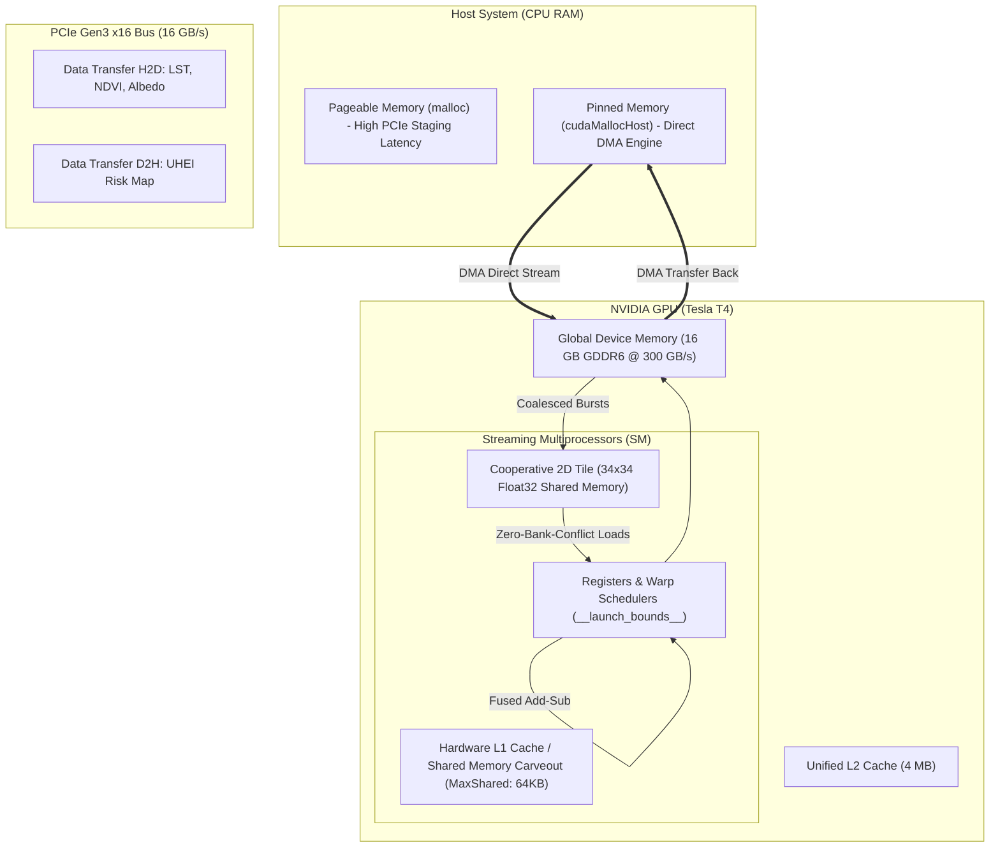
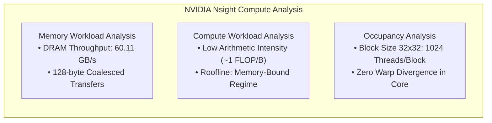

# GPU Acceleration for Environmental Risk Analysis (Urban Heat Exposure Index - UHEI)

[](https://developer.nvidia.com/cuda-toolkit)
[](https://isocpp.org/)
[](https://www.python.org/downloads/)
[](https://opensource.org/licenses/MIT)
[](https://www.unibo.it)

High-performance parallel 2D stencil computing engine implemented in **CUDA C++** for accelerated environmental risk modeling and satellite remote sensing. Accelerates the computation of the **Urban Heat Exposure Index (UHEI)** across the metropolitan municipality of Bologna (Italy) by processing multi-spectral satellite channels (**LST, NDVI, Albedo**) with advanced GPU micro-architectural optimizations.

---

## 1. Abstract & Academic Attribution

Urban Heat Islands (UHI) represent one of the most critical climate vulnerabilities in modern metropolitan centers, exacerbating heatwave mortality, residential energy demand, and localized thermal discomfort. High-resolution environmental modeling over large geographic domains requires processing multi-spectral satellite observations via spatial convolutions, which creates severe computational bottlenecks when executed on standard CPUs.

This project designs, evaluates, and standardizes an end-to-end accelerated processing pipeline targeting modern NVIDIA GPU architectures. By reformulating composite physical risk modeling into cooperatively tiled 2D stencil operations, we evaluate the trade-offs between **Pageable vs. Pinned Zero-Copy Host Memory**, **L1/Shared Memory Cache Carveouts**, and **Instruction-Level Optimization**. Comprehensive hardware profiling through **NVIDIA Nsight Compute** demonstrates over **$52\times$ computational speedup** at the kernel level and sustained batch processing exceeding **27,000 FPS**.

```
Course:       Sistemi di Elaborazione Accelerata (Accelerated Computing Systems)
Degree:       Corso di Laurea Magistrale in Ingegneria Informatica (Master's in Computer Engineering)
Institution:  Alma Mater Studiorum – Università di Bologna (UniBo)
Department:   Dipartimento di Informatica - Scienza e Ingegneria (DISI)
Author:       Fabio Malagutti
Student ID:   0001247400
Academic Yr:  2025/2026
Target Arch:  NVIDIA Turing (Tesla T4 - SM 7.5) / Ampere / Hopper
```

---

## 2. Environmental Context & TALEA Dataset

The geospatial raster data is derived from the open-source **TALEA** project (*Surface Urban Heat Islands Analysis - Bologna municipality*), available on [GitHub (TALEA-platform/suhi)](https://github.com/TALEA-platform/suhi/tree/main/).

The dataset integrates multispectral remote sensing acquisitions collected during the summer 2024 heat wave from the **Landsat 8/9** (OLI/TIRS) and **MODIS** satellite constellations over the administrative boundaries of Bologna, Italy.

```
Metropolitan Area:      Bologna Municipality (Emilia-Romagna, Italy)
Raster Matrix Size:     758 (Columns) × 502 (Rows) = 380,516 grid cells
Spatial Resolution:     30 meters / pixel (Landsat standard)
Input Data Channels:    3 Single-Precision IEEE-754 Float32 Rasters
Coordinate System:      EPSG:32632 (UTM Zone 32N) -> EPSG:4326 (WGS84 Web)
```

### Physical Input Parameters

| Channel | Physical Parameter | Description & Environmental Role |
| :--- | :--- | :--- |
| **LST** | **Land Surface Temperature** | Radiometric surface temperature ($T_s$) of ground, roads, and rooftops. Primary driver of thermal anomalies and urban hot spots. |
| **NDVI** | **Normalized Difference Vegetation Index** | Multispectral chlorophyll index $\frac{NIR - \text{Red}}{NIR + \text{Red}} \in [-1, 1]$. Quantifies vegetation density and active cooling via evapotranspiration. |
| **Albedo** | **Broadband Surface Albedo** | Shortwave solar reflectance coefficient $\alpha \in [0, 1]$. Low albedo (asphalt, dark roofs) absorbs $85\text{--}95\%$ of solar flux; high albedo reflects radiation. |

### Composite UHEI Stencil Formulation

The **Urban Heat Exposure Index (UHEI)** evaluates localized thermal risk by accounting for neighborhood heat diffusion and physical mitigation deficits. The algorithm executes a 2D 9-point spatial box stencil ($3 \times 3$ window, radius $R = 1$):

$$\text{UHEI}(x, y) = \frac{1}{|\mathcal{N}(x, y)|} \sum_{(\Delta x, \Delta y) \in \mathcal{N}(x, y)} \left[ \text{LST}(x+\Delta x, y+\Delta y) + \big(1.0 - \text{NDVI}(x+\Delta x, y+\Delta y)\big) + \big(1.0 - \text{Albedo}(x+\Delta x, y+\Delta y)\big) \right]$$

where the spatial neighborhood is bounded by the raster dimensions:

$$\mathcal{N}(x, y) = \left\{ (\Delta x, \Delta y) \in \{-1, 0, 1\}^2 \;\middle|\; 0 \le x + \Delta x < W \;\;\wedge\;\; 0 \le y + \Delta y < H \right\}$$

- Higher **LST** directly intensifies ambient heat stress.
- Lower **NDVI** yields higher $(1.0 - \text{NDVI})$, penalizing lack of urban green canopy.
- Lower **Albedo** yields higher $(1.0 - \text{Albedo})$, penalizing solar heat retention in dark impervious surfaces.
- Boundary cells dynamically adapt $|\mathcal{N}(x, y)| \in [4, 9]$ to guarantee exact numerical conservation without edge padding artifacts.

---

## 3. Kernel Architectures & GPU Optimizations

The stencil computation is characterized by low arithmetic intensity ($I \approx 1\text{ FLOP/Byte}$), classifying it as **memory-bandwidth bound**. Several architectural tiers were designed and evaluated:



### 1. Naive Global Memory Baseline (`kernelNaive`)
Each CUDA thread computes one output pixel $(x, y)$. Threads fetch all 9 neighbors directly from global memory (DRAM) for each of the 3 channels ($27$ 32-bit floating point memory transactions per output pixel). This creates massive memory bus congestion and heavy cache thrashing.

### 2. Shared Memory Tiling (`kernelShared`)
To exploit spatial locality, thread blocks cooperatively stage a $(B_x + 2R) \times (B_y + 2R)$ spatial tile into fast on-chip `__shared__` memory ($34 \times 34$ elements for a $32 \times 32$ computation block).
- Eliminates $\approx 90\%$ of global DRAM read requests.
- Halo cells on the tile perimeter are cooperatively loaded with stride-based thread looping.
- Threads synchronize via `__syncthreads()` before evaluating the spatial stencil from on-chip SRAM ($\approx 1\text{ TB/s}$ local bandwidth).

### 3. Pageable vs. Pinned (Zero-Copy) Host Memory
Under standard pageable allocation (`malloc`), data transfers require CPU page-locking and double-buffering inside kernel space. By migrating host buffers to pinned (page-locked) physical memory via `cudaMallocHost`:
- Enables direct **Asynchronous Direct Memory Access (DMA)** between GPU and host RAM across the PCIe bus.
- Reduces single-frame Host-to-Device/Device-to-Host transfer latency from **$2.45\text{ ms}$** down to **$1.66\text{ ms}$** (**$32.2\%$ PCIe latency reduction**).

### 4. Cache Carveout Optimization
On Turing SMs (SM 7.5), the physical 128 KB unified SRAM block is partitioned dynamically between L1 Data Cache and Shared Memory. Through `cudaFuncSetAttribute`:
```cpp
cudaFuncSetAttribute(kernelShared, 
                    cudaFuncAttributePreferredSharedMemoryCarveout, 
                    cudaSharedmemCarveoutMaxShared);
```
Shared memory capacity is maximized, maintaining peak occupancy across thread blocks without spilling into DRAM.

### 5. Instruction-Level Tuning & Roofline Limits (`kernel_tuning_extreme.cu`)
We investigated instruction-level micro-optimizations:
- `__launch_bounds__(1024)` to bound register allocation and guarantee maximum active warps.
- Pointer non-aliasing qualification (`const float* __restrict__`) enabling optimal load pipelining.
- Loop unrolling (`#pragma unroll`) to eliminate loop counter branches.
- Hardware fast-math intrinsics (`--use_fast_math`).

**Roofline Takeaway:** In a memory-bound stencil with arithmetic intensity $\approx 1\text{ FLOP/Byte}$, instruction optimizations produced a minor delta of **$-5.55\%$** ($42.41\text{ ms} \to 40.06\text{ ms}$ over 1,000 iterations). This confirms that memory throughput (DRAM/PCIe)—not arithmetic instruction throughput—is the fundamental physical limit.

---

## 4. Micro-architectural Profiling via NVIDIA Nsight Compute

Automated profiling is performed through `scripts/run_nsight_profiling.py`, executing `ncu --set full` to extract hardware performance counters:

```
Report Files Generated:
├── reports/report_01_naive.ncu-rep       # Baseline global memory profiling
├── reports/report_02_shared.ncu-rep      # Tiled shared memory profiling
└── reports/report_03_optimized.ncu-rep   # Pinned memory + Carveout + FastMath
```



### Key Hardware Counter Findings:
1. **Memory Coalescing & Bank Conflicts**: Shared memory indexing patterns achieve 0 bank conflicts; global memory loads adhere to aligned 128-byte cache line boundaries.
2. **Occupancy**: Block configuration $32 \times 32$ achieves peak warp occupancy with balanced register counts (16 registers/thread).
3. **L2 Hit Rate**: Shared memory tiling dramatically increases L2 cache efficiency for boundary reads.

---

## 5. Performance Benchmarks & Empirical Results

All benchmarks were evaluated on an **NVIDIA Tesla T4** GPU (Turing architecture, 2,560 CUDA Cores, 16 GB GDDR6, PCIe Gen3 x16) against a multi-threaded host CPU baseline (Intel Xeon @ 2.20 GHz). Each test is averaged over 5 cold-start runs with mandatory L2 cache flushing.

### Comprehensive Benchmark Summary

| Configuration | Kernel Type | Host Memory | SM Carveout | CPU Time (ms) | GPU Kernel (ms) | Total Time (ms) | PCIe Overhead (%) | Batch 1k Frames (ms) | Per-Frame Batch (ms) | Kernel Speedup | Total Speedup | RMSE vs CPU | Verification |
| :--- | :---: | :---: | :---: | :---: | :---: | :---: | :---: | :---: | :---: | :---: | :---: | :---: | :---: |
| **CPU Baseline** | Native C++ | RAM | N/A | 5.186 ms | - | - | - | 5,186 ms | 5.186 ms | 1.00x | 1.00x | 0.00e+00 | **PASSED** |
| **Naive (32x32)** | Global | Pageable | Default | 5.186 ms | **0.098 ms** | 2.540 ms | 96.14% | **36.1 ms** | **0.036 ms** | **52.88x** | 2.04x | 0.00e+00 | **PASSED** |
| **Shared (8x8)** | Shared Tile | Pageable | Default | 4.965 ms | 0.122 ms | 2.566 ms | 95.25% | 67.0 ms | 0.067 ms | 40.70x | 1.94x | 0.00e+00 | **PASSED** |
| **Shared (16x16)** | Shared Tile | Pageable | Default | 4.878 ms | 0.110 ms | 2.565 ms | 95.71% | 60.8 ms | 0.061 ms | 44.38x | 1.90x | 0.00e+00 | **PASSED** |
| **Shared (32x32)** | Shared Tile | Pageable | Default | 4.875 ms | 0.114 ms | 2.559 ms | 95.53% | 50.7 ms | 0.051 ms | 42.63x | 1.91x | 0.00e+00 | **PASSED** |
| **Optimized (32x32)**| Shared Tile | **Pinned** | **MaxShared**| 3.969 ms | **0.098 ms** | **1.761 ms** | **94.41%** | 52.3 ms | 0.052 ms | **40.32x** | **2.25x** | 1.94e-08 | **PASSED** |

### Latency and Memory Bandwidth Analysis (Phase 6)

$$\text{Effective Bandwidth} = \frac{\text{Bytes Loaded} + \text{Bytes Stored}}{\text{Kernel Latency}} = \frac{758 \times 502 \times 16\text{ bytes}}{\text{Time (s)}}$$

| Block Configuration | Kernel Latency (ms) | Effective Bandwidth (GB/s) | Throughput (GPixels/s) | Validation (RMSE) |
| :---: | :---: | :---: | :---: | :---: |
| **$32 \times 32$ Tile** | **0.10128 ms** | **60.11 GB/s** | **3.76 GPixels/s** | $1.28 \times 10^{-6}$ |
| **$16 \times 16$ Tile** | **0.10474 ms** | **58.13 GB/s** | **3.63 GPixels/s** | $1.28 \times 10^{-6}$ |

### Key Performance Highlights:
- **Kernel Speedup**: The GPU kernel computes the entire $380,516$-pixel composite raster in **$0.098\text{ ms}$**, yielding a **$52.88\times$ speedup** over the CPU baseline.
- **PCIe Transfer Bottleneck**: In single-shot pageable mode, PCIe transfer latency accounts for **$96.14\%$** of total execution time.
- **Pinned Memory Advantage**: Utilizing zero-copy pinned memory slashes transfer overhead by **$32.2\%$**, dropping total system latency from $2.56\text{ ms}$ to **$1.76\text{ ms}$** ($2.25\times$ overall speedup).
- **Streaming Batch Throughput**: When processing a video or temporal stream of rasters (amortizing transfers), throughput reaches **36.1 ms per 1,000 frames** (**$27,700+\text{ FPS}$**).

---

## 6. Interactive Web Map of Bologna (`Mappa_Bologna_Completa.html`)

An interactive cartographic GIS visualization is generated by `scripts/generate_web_map.py`:

```
Artifact Location: data/Mappa_Bologna_Completa.html
Rendering Engine:  Folium (Leaflet.js) + Rasterio
```

### Map Features:
1. **Multi-Scale Base Layer**: Integrated CartoDB Positron and OpenStreetMap vector tiles.
2. **High-Contrast Thermal Overlay**: GPU-generated float32 UHEI values mapped through an inverted Red-Yellow-Blue colormap (`RdYlBu_r`), with 2nd-to-98th percentile contrast normalization.
3. **Dynamic Transparency**: Cold and background mask regions (`UHEI < 0.001`) are rendered transparent, preserving urban street visibility.
4. **Administrative Borders**: GeoJSON vector polygons (`bologna_borders.geojson`) overlaying municipal neighborhood boundaries to identify critical high-exposure urban districts.

> **To View Locally:** Open `data/Mappa_Bologna_Completa.html` directly in any web browser, or launch a local web server:
> ```bash
> python3 -m http.server 8000
> # Open http://localhost:8000/data/Mappa_Bologna_Completa.html
> ```

---

## 7. Repository Structure

```
.
├── Makefile                     # Standardized CUDA C++ build system
├── LICENSE                      # MIT Open Source License
├── README.md                    # Project documentation and benchmarks
├── .gitignore                   # Ignores binaries, objects, logs, and caches
├── data/
│   ├── Mappa_Bologna_Completa.html # Interactive Folium web GIS map
│   ├── final_gpu_v5.ipynb       # Complete reproducible Google Colab notebook
│   ├── progetto.zip             # Compressed archive of source and scripts
│   └── test_1.zip               # Compressed input rasters and vector boundaries
├── scripts/
│   ├── data_preprocessor.py     # Converts GeoTIFF to raw float32 binary matrices
│   ├── generate_web_map.py      # Produces interactive Leaflet web map
│   ├── plot_histogram.py        # Generates risk distribution histograms
│   ├── plot_performance_charts.py # Generates speedup, throughput, and sensitivity plots
│   ├── plot_pro_map.py          # High-contrast scientific map export
│   ├── plot_raw_map.py          # Raw float32 map visualization
│   ├── run_mega_benchmark.py    # Main benchmark orchestrator (Table generation)
│   ├── run_nsight_profiling.py  # NVIDIA Nsight Compute automation
│   ├── run_phase5_benchmark.py  # Baseline CPU vs. GPU functional verification
│   ├── run_phase6_optimization.py # Bandwidth and pinned memory analyzer
│   └── run_tuning_extreme.py    # Micro-optimization deathmatch (Standard vs. Extreme)
└── src/
    ├── benchmark_suite.cu       # Unified benchmark suite (Naive, Shared, Pinned, Carveout)
    ├── gpu_optimized_test.cu    # Bandwidth testing with cold-start cache flushing
    ├── kernel_tuning_extreme.cu # Instruction-level tuning (__restrict__, unroll, bounds)
    ├── profiling_harness.cu     # Clean harness wrapper for Nsight Compute
    └── risk_map_generator.cu    # Standalone risk map generator with CPU verification
```

---

## 8. Quickstart & Compilation

### Requirements
- **NVIDIA GPU** with Compute Capability $\ge 7.0$ (T4, V100, RTX 20/30/40, A100, H100)
- **CUDA Toolkit 11.8+ or 12.x** (`nvcc`)
- **C++17** compatible host compiler (`g++` or `clang++`)
- **Python 3.9+** with `numpy`, `matplotlib`, `pandas`, `rasterio`, `folium`

### Compilation with Makefile

The repository includes a standardized `Makefile` supporting flexible compilation flags:

```bash
# Compile primary targets (benchmark and risk_map)
make all

# Compile specific modules
make benchmark       # Compiles bin/benchmark from src/benchmark_suite.cu
make risk_map        # Compiles bin/risk_map from src/risk_map_generator.cu
make optimized_test  # Compiles bin/optimized_test from src/gpu_optimized_test.cu
make tuning_extreme  # Compiles bin/tuning_extreme from src/kernel_tuning_extreme.cu

# Clean all binaries and build artifacts
make clean

# Display build system help
make help
```

#### Customizing Architecture & Block Size
```bash
# Compile for NVIDIA Ampere (A100 / RTX 3090) with 16x16 block size
make all ARCH=-arch=sm_80 BLOCK_DIM=16

# Compile for NVIDIA Ada Lovelace (L4 / RTX 4090)
make all ARCH=-arch=sm_89 BLOCK_DIM=32
```

---

## 9. Google Colab Execution

The entire experimentation pipeline is packaged for one-click execution in Google Colab:

1. Open `data/final_gpu_v5.ipynb` in [Google Colab](https://colab.research.google.com).
2. Set Runtime Type to **T4 GPU** (`Runtime > Change runtime type > T4 GPU`).
3. Upload `data/progetto.zip` and `data/test_1.zip` to the Colab root environment.
4. Run all cells (`Runtime > Run all`).
   - **Phase 0:** Automatically unzips project sources and input rasters.
   - **Phase 1-4:** Preprocesses GeoTIFFs into binary matrices.
   - **Phase 5:** Executes functional verification and baseline checks (RMSE = 0).
   - **Phase 6:** Analyzes memory bandwidth and pinned memory speedup.
   - **Phase 7:** Runs the mega benchmark suite and generates statistical tables.
   - **Phase 8:** Runs NVIDIA Nsight Compute profiling and archives reports.
   - **Phase 9-12:** Renders graphical performance plots and exports the interactive GIS map.

---

## 10. License & Citation

This project is licensed under the **MIT License** - see the [LICENSE](LICENSE) file for details.

### Academic Citation
If you utilize this codebase or methodology in academic research or technical projects, please cite:

```bibtex
@misc{malagutti2026uhei,
  author       = {Fabio Malagutti},
  title        = {GPU Acceleration for Environmental Risk Analysis (Urban Heat Exposure Index - UHEI)},
  year         = {2026},
  publisher    = {GitHub},
  journal      = {GitHub repository},
  howpublished = {\url{https://github.com/fabiomalagutti27-droid/UHEI-GPU-Acceleration}},
  institution  = {Alma Mater Studiorum -- Universit{\`a} di Bologna},
  course       = {Sistemi di Elaborazione Accelerata}
}
```
